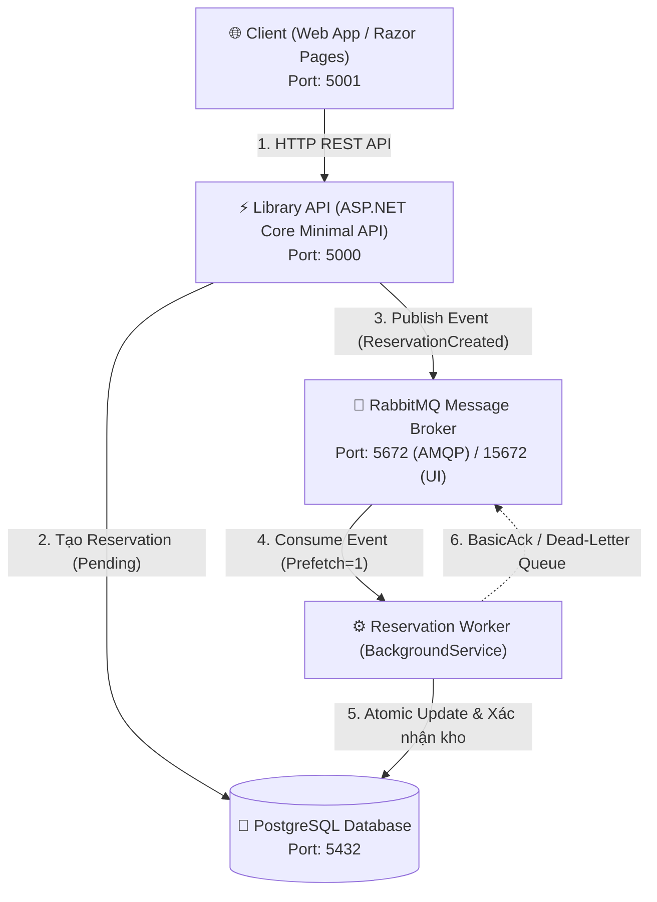
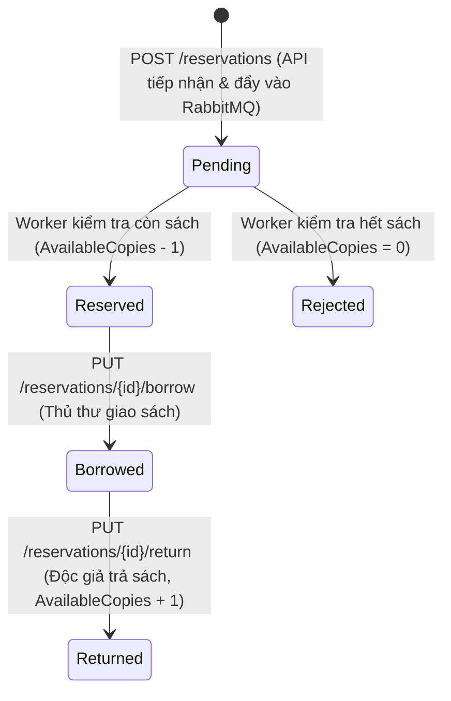

# BÀI TẬP LỚN: HỆ THỐNG THƯ VIỆN VÀ ĐẶT MƯỢN SÁCH PHÂN TÁN
### Học phần: Phát triển ứng dụng phân tán — Đề tài 20
**Tên GitHub Repository khuyến nghị:** `ptudpt-de20-library-reservation-system`

---

## 1. Giới thiệu bài toán

Hệ thống thư viện cho phép độc giả tra cứu danh mục sách, kiểm tra số lượng bản sách đang khả dụng và gửi yêu cầu đặt mượn. Quá trình tiếp nhận và xác nhận giữ sách được thiết kế theo **mô hình xử lý bất đồng bộ hướng sự kiện (Event-Driven / Asynchronous Messaging)** sử dụng **RabbitMQ Message Broker**. 

Kiến trúc này mang lại các ưu điểm phân tán vượt trội:
- **Tách rời các thành phần (Decoupling)**: Web API tiếp nhận yêu cầu cực nhanh mà không bị nghẽn bởi logic kiểm tra kho hay lock database.
- **Kiểm soát lưu lượng (Traffic Shaping & Rate Limiting)**: Hàng đợi RabbitMQ đóng vai trò bộ đệm (buffer) điều tiết tải, Worker tiêu thụ tuần tự từng thông điệp.
- **Khả năng chịu lỗi & tự phục hồi (Fault Tolerance & High Availability)**: Khi Worker tạm dừng hoặc gặp sự cố, các yêu cầu đặt mượn vẫn được lưu trữ an toàn trong hàng đợi Durable của RabbitMQ và sẽ tự động được xử lý ngay khi Worker hoạt động trở lại.
- **Ngăn chặn triệt để Over-booking (Concurrency Safety)**: Sử dụng kỹ thuật cập nhật nguyên tử (Atomic SQL Update) đảm bảo không bao giờ xảy ra tình trạng một cuốn sách bị mượn vượt quá số lượng sẵn có trong kho.

---

## 2. Kiến trúc hệ thống phân tán



### Các thành phần chính trong hệ thống:
1. **Library.Contracts**: Chứa các DTO, Enum trạng thái và Message Contracts dùng chung.
2. **Library.Data**: Chứa Entity models, DbContext (EF Core) và dữ liệu khởi tạo mẫu (Seed Data).
3. **Library.Api**: Web API xây dựng bằng ASP.NET Core Minimal API, tiếp nhận các request từ người dùng, lưu trạng thái ban đầu `Pending` và đẩy thông điệp vào RabbitMQ (`202 Accepted`).
4. **Library.Worker**: Dịch vụ nền (BackgroundService) lắng nghe hàng đợi RabbitMQ, thực hiện kiểm tra số lượng sách khả dụng bằng Atomic SQL Update và chuyển trạng thái sang `Reserved` hoặc `Rejected`.
5. **Library.WebClient**: Giao diện người dùng Web App (Razor Pages), cung cấp trải nghiệm tra cứu sách, gửi yêu cầu đặt mượn, theo dõi tiến trình xử lý và hỗ trợ thủ thư cập nhật giao / nhận trả sách.
6. **PostgreSQL & RabbitMQ**: Chạy độc lập dưới dạng container Docker, kết nối qua mạng nội bộ Docker (`library-network`).

---

## 3. Máy trạng thái của yêu cầu đặt mượn (State Machine)



---

## 4. Danh mục API (ASP.NET Core Minimal API)

Tài liệu Swagger UI tương tác trực tiếp có tại: `http://localhost:5000/swagger`

| STT | Phương thức | Đường dẫn API | Mô tả nghiệp vụ | Mã phản hồi HTTP |
|:---:|:---:|:---|:---|:---:|
| 1 | `GET` | `/books` | Tra cứu danh sách sách (hỗ trợ lọc `search`, `category`) | `200 OK` |
| 2 | `GET` | `/books/{id}` | Tra cứu chi tiết sách và số bản khả dụng | `200 OK` / `404 Not Found` |
| 3 | `POST` | `/reservations` | Gửi yêu cầu đặt mượn (đẩy vào RabbitMQ xử lý bất đồng bộ) | `202 Accepted` |
| 4 | `GET` | `/reservations/{id}` | Tra cứu trạng thái xử lý của một yêu cầu đặt mượn | `200 OK` / `404 Not Found` |
| 5 | `GET` | `/users/{userId}/reservations` | Tra cứu lịch sử đặt/mượn của một độc giả | `200 OK` |
| 6 | `PUT` | `/reservations/{id}/borrow` | Thủ thư xác nhận giao sách cho độc giả (`Reserved` $\rightarrow$ `Borrowed`) | `200 OK` / `400 Bad Request` |
| 7 | `PUT` | `/reservations/{id}/return` | Độc giả hoàn trả sách (`Borrowed` $\rightarrow$ `Returned`, cộng lại kho) | `200 OK` / `400 Bad Request` |
| 8 | `GET` | `/healthz` | Health check chi tiết tình trạng PostgreSQL và RabbitMQ | `200 OK` / `503 Service Unavailable` |

---

## 5. Các tính năng nâng cao & Yêu cầu mở rộng

1. **Correlation ID (X-Correlation-Id)**: Mỗi yêu cầu từ Client được gán một mã định danh duy nhất. Mã này được ghi vào HTTP header, luân chuyển qua RabbitMQ message header, và xuất hiện xuyên suốt trong log của API lẫn Worker giúp truy vết luồng xử lý (Distributed Tracing).
2. **Ngăn chặn Over-booking bằng Atomic SQL Update**:
   ```sql
   UPDATE "Books" 
   SET "AvailableCopies" = "AvailableCopies" - 1 
   WHERE "Id" = @BookId AND "AvailableCopies" > 0;
   ```
   Tránh hoàn toàn Race Condition ngay cả khi nhiều Worker hoặc nhiều luồng chạy song song.
3. **Dead-Letter Queue (DLQ)**: Hàng đợi chính `book-reservations` được liên kết với `dlx.book-reservations` và dead-letter queue `book-reservations.dlq` để cô lập các thông điệp bị lỗi/hỏng, tránh gây tắc nghẽn hệ thống.
4. **Idempotent Consumer**: Worker kiểm tra trạng thái của bản ghi trước khi trừ kho, tránh trừ bản sách 2 lần nếu nhận lại thông điệp trùng lặp.
5. **Cấu hình độc lập (12-Factor App)**: Toàn bộ chuỗi kết nối, thông số RabbitMQ và cổng dịch vụ được cấu hình qua biến môi trường (Environment Variables) trong `docker-compose.yml`, không hardcode trong mã nguồn.
6. **Health Check đa thành phần**: Endpoint `/healthz` giám sát đồng thời cả cơ sở dữ liệu PostgreSQL và hàng đợi RabbitMQ.

---

## 6. Hướng dẫn cài đặt và khởi chạy hệ thống

### Yêu cầu tiên quyết:
- Đã cài đặt **Docker** và **Docker Compose** (ví dụ: Docker Desktop trên Windows/macOS hoặc Docker Engine trên Linux).

### Các bước khởi chạy:

1. **Khởi chạy toàn bộ hệ thống bằng Docker Compose:**
   ```bash
   docker compose up -d --build
   ```

2. **Kiểm tra trạng thái các container:**
   ```bash
   docker compose ps
   ```
   *Cả 5 service (`postgres`, `rabbitmq`, `library-api`, `reservation-worker`, `web-client`) phải ở trạng thái `running` (hoặc `healthy`).*

3. **Truy cập các địa chỉ dịch vụ:**
   - **Giao diện Web Client:** [http://localhost:5001](http://localhost:5001)
   - **Tài liệu API Swagger:** [http://localhost:5000/swagger](http://localhost:5000/swagger)
   - **RabbitMQ Management Dashboard:** [http://localhost:15672](http://localhost:15672) *(Tài khoản: `guest` / `guest`)*
   - **Health Check Endpoint:** [http://localhost:5000/healthz](http://localhost:5000/healthz)

---

## 7. Khởi tạo Git và Upload lên GitHub

Để tạo lịch sử commit thể hiện quá trình làm bài tập lớn theo yêu cầu:

1. **Chạy script tự động tạo commit:**
   - Trên PowerShell:
     ```powershell
     powershell -ExecutionPolicy Bypass -File scripts\setup-git.ps1 -GitHubUsername <ten-tai-khoan-github>
     ```
   - Hoặc nhấp đúp file `setup-git.bat`.

2. **Tạo repository mới trên GitHub:**
   - Tên repository: `ptudpt-de20-library-reservation-system`
   - Đặt ở chế độ `Public`.

3. **Push toàn bộ lên GitHub:**
   ```bash
   git push -u origin main
   ```

---

## 8. Kịch bản minh họa & Demo khi chấm thi

Trong thư mục `scripts/` đã tích hợp sẵn 3 kịch bản kiểm thử tự động bằng PowerShell:

### Kịch bản 1: Kiểm thử toàn diện luồng chính (End-to-End Test)
```powershell
powershell -ExecutionPolicy Bypass -File scripts\test-system.ps1
```
*Kịch bản sẽ kiểm tra Health check, tra cứu sách, gửi yêu cầu đặt mượn, theo dõi Worker xử lý đổi trạng thái sang `Reserved`, sau đó thực hiện giao sách (`Borrowed`) và trả sách (`Returned`), hoàn trả số bản khả dụng.*

### Kịch bản 2: Kiểm thử Chịu lỗi & Tự phục hồi khi Worker dừng (Resilience Test)
```powershell
powershell -ExecutionPolicy Bypass -File scripts\test-resilience.ps1
```
*Kịch bản sẽ:*
1. Dừng container Worker: `docker compose stop reservation-worker`
2. Gửi yêu cầu đặt mượn: API vẫn trả về `202 Accepted`, message lưu an toàn trong RabbitMQ, trạng thái trong DB là `Pending`.
3. Bật lại container Worker: `docker compose start reservation-worker`
4. Worker tự động kết nối lại, tiêu thụ message tồn đọng và cập nhật trạng thái thành `Reserved` mà không làm mất dữ liệu.

### Kịch bản 3: Kiểm thử Tranh chấp đồng thời (Concurrency & Race Condition Test)
```powershell
powershell -ExecutionPolicy Bypass -File scripts\test-race-condition.ps1
```
*Kịch bản chọn cuốn sách chỉ có **1 bản duy nhất** trong kho (`The Pragmatic Programmer`), sau đó bắn đồng thời 5 yêu cầu đặt mượn. Kết quả chứng minh: Đúng 1 yêu cầu thành công (`Reserved`), 4 yêu cầu còn lại bị từ chối (`Rejected`), và số bản khả dụng trong kho không bao giờ bị âm.*

---

## 9. Cấu trúc thư mục mã nguồn

```text
dbel/
├── src/
│   ├── Library.Contracts/          # DTOs, Enums, Event message contracts
│   ├── Library.Data/               # EF Core DbContext, Entities, SeedData
│   ├── Library.Api/                # ASP.NET Core Minimal API, RabbitMQ Publisher, Dockerfile
│   ├── Library.Worker/             # BackgroundService, RabbitMQ Consumer, Dockerfile
│   └── Library.WebClient/          # ASP.NET Core Razor Pages Web UI, Dockerfile
├── scripts/
│   ├── setup-git.ps1               # Script khởi tạo Git và tạo lịch sử commit
│   ├── test-system.ps1             # Script test tự động toàn bộ luồng
│   ├── test-resilience.ps1         # Script test chịu lỗi khi worker dừng
│   └── test-race-condition.ps1     # Script test tranh chấp tài nguyên đồng thời
├── setup-git.bat                   # File chạy nhanh setup git trên Windows
├── docker-compose.yml              # File khởi chạy toàn bộ 5 dịch vụ
├── .env.example                    # Mẫu cấu hình biến môi trường (an toàn để commit)
├── .gitignore                      # Cấu hình bỏ qua file nhị phân & file .env nhạy cảm
├── README.md                       # Tài liệu hướng dẫn chi tiết
└── LibrarySystem.sln               # Visual Studio Solution
```
